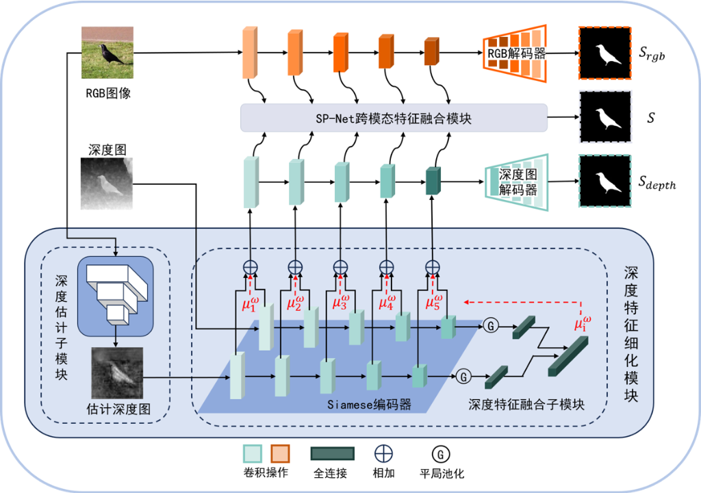

# RDSP-Net: RGB-D Salient Object Detection via Depth Feature Refinement

<p align="center">
  <b>English</b> | <a href="./README_zh.md">简体中文</a>
</p>

This repository contains the official implementation and interactive demo system for **RDSP-Net** (*Research on RGB-D Salient Object Detection Based on Depth Feature Refinement* / 2024 Graduation Thesis at Wuhan University of Technology), including the core network definitions, PyTorch-to-ONNX export scripts, and a Gradio + ONNX Runtime web interface.

---

## Overall Architecture

<p align="center">
  
</p>

As illustrated above, **RDSP-Net** consists of two primary stages:
1. **Depth Feature Refinement Module (深度特征细化模块)**:
   - **Depth Estimation Sub-module (深度估计子模块)**: Estimates a calibrated depth map from the input RGB image and multi-scale RGB features (`DCF_ResNet` + `depth_estimator`).
   - **Siamese Encoder & Depth Feature Fusion Sub-module (Siamese编码器与深度特征融合子模块)**: Extracts multi-scale features from both the original depth map and the estimated depth map via a Siamese encoder, then adaptively fuses them using channel-wise global average pooling and learned fusion weights $\mu_i^\omega$.
2. **SP-Net Cross-Modal Feature Fusion Module (SP-Net跨模态特征融合模块)**:
   - Fuses the multi-scale RGB features and the refined depth features to produce the final salient object prediction $S$, along with auxiliary supervision outputs $S_{rgb}$ and $S_{depth}$.

---

## Repository Structure

```text
RDSP-Net/
├── assets/
│   └── architecture.png          # Overall architecture diagram of RDSP-Net
├── Code/
│   ├── evaluateSOD_pre/          # Salient Object Detection (SOD) evaluation module (MAE, etc.)
│   │   ├── dataloader.py
│   │   ├── evaluator.py
│   │   └── main.py
│   ├── lib/                      # Core network architectures
│   │   ├── DCF_ResNet_models.py      # RGB feature extractor & depth calibration network (DCF_ResNet)
│   │   ├── depth_calibration_models.py # Depth estimator (depth_estimator) & discriminator
│   │   ├── HolisticAttention.py      # Holistic Attention module
│   │   ├── model.py                  # Main RGB-D SOD network (SPNet / CDSPNet / RDSP-Net)
│   │   ├── ResNet.py                 # ResNet backbone
│   │   └── res2net_v1b_base.py       # Res2Net backbone
│   └── utils/                    # Data loading, preprocessing, evaluation metrics, and options
│       ├── config.py
│       ├── data.py
│       ├── data_pre.py
│       ├── dataloader.py
│       ├── eva_funcs.py
│       ├── evaluator.py
│       ├── options.py
│       ├── utils.py
│       └── utils_pre.py
├── Generate_onnx.py              # Script to export PyTorch weights (.pth) to ONNX models (.onnx)
├── data_gadio.py                 # Gradio demo data preprocessing (v1)
├── data_gradio_version_2.py      # Gradio demo data preprocessing (v2, supports loading GT by filename)
├── main_version_1.py             # Gradio demo app v1 (Initial release)
├── main_version_2.py             # Gradio demo app v2 (Auto-queries and displays Ground Truth masks)
├── main_version_3.py             # Gradio demo app v3 (Unified Gallery view + warm-up inference)
├── main_version_4.py             # Gradio demo app v4 (Refined UI for RDSP-Net)
├── README.md                     # English documentation (Default)
└── README_zh.md                  # Chinese documentation
```

---

## Requirements

Python 3.8+ is recommended. Install the required packages via `pip`:

```bash
pip install torch torchvision onnx onnxruntime-gpu gradio numpy Pillow
```

> **Note:** If you are running on a CPU-only machine, install `onnxruntime` instead of `onnxruntime-gpu` and change `CUDAExecutionProvider` to `CPUExecutionProvider` in the inference scripts.

---

## Quick Start

### 1. Export ONNX Models

Place the trained PyTorch checkpoints under the `./Checkpoint/` directory:
- `./Checkpoint/DCF_rgb_epoch_best.pth`
- `./Checkpoint/DCF_estimator.pth.195`
- `./Checkpoint/CDSPNet_epoch_best.pth`

Run the ONNX export script:

```bash
python Generate_onnx.py
```

This generates three `.onnx` model files in the project root directory:
- `DCF_rgb_epoch_best.onnx`
- `DCF_estimator_195.onnx`
- `CDSPNet_epoch_best.onnx`

### 2. Launch the Gradio Interactive Demo

Make sure the three `.onnx` models are located in the project root directory (to enable automatic Ground Truth comparison, place the test set GT masks inside `./Data/TestDataset2_GT`), then run:

```bash
python main_version_4.py
```

Open the local URL printed in the terminal (default: `http://127.0.0.1:7860`) in your browser, upload an **RGB image** and a **Depth map**, and click **推理 (Generate)** to visualize:
1. Input RGB Image
2. Input Depth Map
3. Estimated Depth Map
4. Predicted Saliency Map
5. Ground Truth Saliency Map (GT)

---

## Demo Version History

| File | Description |
| :--- | :--- |
| `main_version_1.py` | Initial Gradio web UI supporting RGB and depth image upload with ONNX Runtime inference. |
| `main_version_2.py` | Automatically searches `./Data/TestDataset2_GT` by filename to display the corresponding Ground Truth mask. |
| `main_version_3.py` | Consolidates all outputs into a unified `Gallery` component, adds a `Clear All` button, and runs a warm-up inference on startup to eliminate first-run latency. |
| `main_version_4.py` | Refines component labels and names the model tab `RDSP-Net`. |
