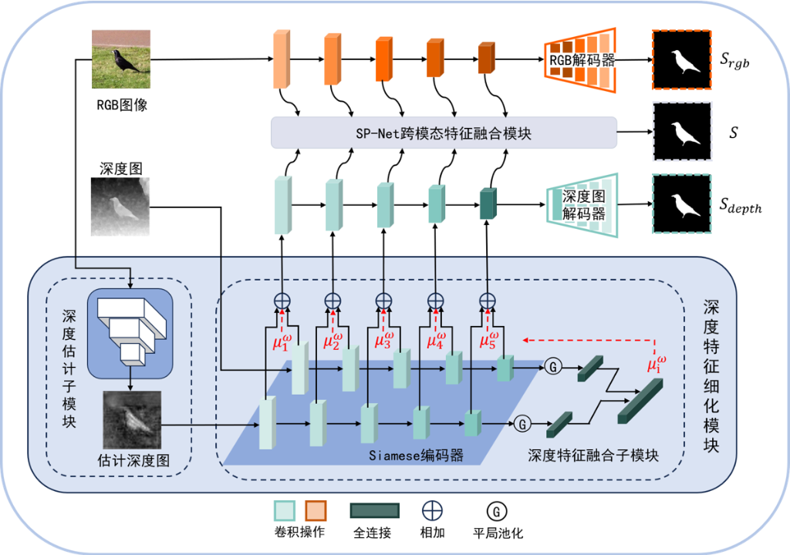

# RDSP-Net：基于深度特征细化的 RGB-D 显著目标检测方法研究

<p align="center">
  <a href="./README.md">English</a> | <b>简体中文</b>
</p>

本项目为 2024 届武汉理工大学毕业设计代码仓库：**《基于深度特征细化的 RGB-D 显著目标检测方法研究》（RDSP-Net）**，包含核心网络定义、PyTorch 转 ONNX 模型导出脚本以及基于 Gradio + ONNX Runtime 的可视化交互演示系统。

---

## 总体网络架构

<p align="center">
  
</p>

如图所示，**RDSP-Net** 主要由以下核心模块构成：
1. **深度特征细化模块**：
   - **深度估计子模块**：利用输入 RGB 图像及多尺度 RGB 特征生成估计深度图（对应 `DCF_ResNet` 与 `depth_estimator`）。
   - **Siamese 编码器与深度特征融合子模块**：通过孪生（Siamese）编码器分别提取原始深度图与估计深度图的多尺度特征，并经全局平均池化与全连接层计算自适应融合权重 $\mu_i^\omega$，对多尺度深度特征进行加权细化。
2. **SP-Net 跨模态特征融合模块**：
   - 将多尺度 RGB 特征与细化后的深度特征进行跨模态交互融合，最终输出预测显著图 $S$（以及辅助监督输出 $S_{rgb}$ 与 $S_{depth}$）。

---

## 目录结构

```text
RDSP-Net/
├── assets/
│   └── architecture.png          # RDSP-Net 总体网络结构图
├── Code/
│   ├── evaluateSOD_pre/          # 显著目标检测 (SOD) 评估模块 (MAE 等指标计算)
│   │   ├── dataloader.py
│   │   ├── evaluator.py
│   │   └── main.py
│   ├── lib/                      # 核心网络结构定义
│   │   ├── DCF_ResNet_models.py      # RGB 特征提取与深度校准网络 (DCF_ResNet)
│   │   ├── depth_calibration_models.py # 深度估计器 (depth_estimator) 与判别器 (discriminator)
│   │   ├── HolisticAttention.py      # 整体注意力模块 (Holistic Attention)
│   │   ├── model.py                  # 主干显著目标检测网络 (SPNet / CDSPNet / RDSP-Net)
│   │   ├── ResNet.py                 # ResNet 主干网络
│   │   └── res2net_v1b_base.py       # Res2Net 主干网络
│   └── utils/                    # 数据加载、预处理、评估函数与配置工具
│       ├── config.py
│       ├── data.py
│       ├── data_pre.py
│       ├── dataloader.py
│       ├── eva_funcs.py
│       ├── evaluator.py
│       ├── options.py
│       ├── utils.py
│       └── utils_pre.py
├── Generate_onnx.py              # 将 PyTorch 权重 (.pth) 导出为 ONNX 模型 (.onnx)
├── data_gadio.py                 # Gradio 演示系统数据预处理 (v1)
├── data_gradio_version_2.py      # Gradio 演示系统数据预处理 (v2，支持按文件名加载 GT)
├── main_version_1.py             # Gradio 演示系统 v1 (初版)
├── main_version_2.py             # Gradio 演示系统 v2 (新增自动查询并展示真实显著图 GT)
├── main_version_3.py             # Gradio 演示系统 v3 (Gallery 汇总展示 + 启动预热推理)
├── main_version_4.py             # Gradio 演示系统 v4 (中文界面优化，模型命名为 RDSP-Net)
├── README.md                     # 英文说明文档 (默认)
└── README_zh.md                  # 中文说明文档
```

---

## 环境依赖

建议使用 Python 3.8+，主要依赖库如下：

```bash
pip install torch torchvision onnx onnxruntime-gpu gradio numpy Pillow
```

> 如在无 GPU 环境下运行，可安装 `onnxruntime` 并将推理脚本中的 `CUDAExecutionProvider` 调整为 `CPUExecutionProvider`。

---

## 使用说明

### 1. 导出 ONNX 模型

将训练好的 PyTorch 权重文件放入 `./Checkpoint/` 目录下：
- `./Checkpoint/DCF_rgb_epoch_best.pth`
- `./Checkpoint/DCF_estimator.pth.195`
- `./Checkpoint/CDSPNet_epoch_best.pth`

运行导出脚本：

```bash
python Generate_onnx.py
```

执行后会在项目根目录生成三个对应的 ONNX 模型文件：
- `DCF_rgb_epoch_best.onnx`
- `DCF_estimator_195.onnx`
- `CDSPNet_epoch_best.onnx`

### 2. 启动 Gradio 演示系统

确保根目录下已存在上述三个 `.onnx` 模型文件（若需自动匹配展示 GT 图像，可将测试集真实标签放置于 `./Data/TestDataset2_GT` 目录），运行最新版演示界面：

```bash
python main_version_4.py
```

启动后在浏览器访问终端输出的本地地址（默认 `http://127.0.0.1:7860`），上传 **RGB 图像** 与 **深度图像**，点击 **推理** 即可查看：
1. RGB 图像
2. 原始深度图像
3. 估计深度图像
4. 预测显著图
5. 真实显著图 (GT)

---

## 版本演进说明

| 文件 | 版本说明 |
| :--- | :--- |
| `main_version_1.py` | 初版 Gradio 交互界面，支持上传 RGB 与深度图并基于 ONNX Runtime 进行推理。 |
| `main_version_2.py` | 支持根据输入图像文件名在 `./Data/TestDataset2_GT` 中自动检索并显示对应的 GT 标签。 |
| `main_version_3.py` | 将所有输出结果整合至 `Gallery` 组件统一展示，新增“清空”按钮，并在服务启动前执行预热推理以消除首次推理延迟。 |
| `main_version_4.py` | 全面汉化 GUI 组件标签，将演示系统模型页签命名为 `RDSP-Net`。 |
